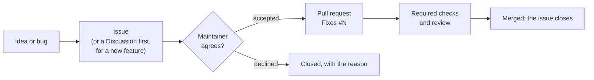

# Contributing to Whizbang

Thank you for your interest in contributing to Whizbang! This document provides guidelines and instructions for contributing.

## How a change gets in

**Every pull request implements an accepted issue.** Talk first, code second: the issue is where a
change's value, design and approach are agreed, and it is far cheaper to change direction there than in
review.



1. **Open an issue** with one of the [forms](https://github.com/whizbang-lib/whizbang/issues/new/choose),
   or comment on an existing one. New features start in
   [Discussions](https://github.com/whizbang-lib/whizbang/discussions/categories/ideas).
2. **Wait for `accepted`.** A maintainer labels the issue `accepted` once its value and approach are
   agreed. An issue a maintainer opens is accepted when it is opened. Issues labeled `accepted` and `help wanted` or `good first issue` are open for anyone to take:
   say so on the issue first.
3. **Open the pull request** with `Fixes #N` in the description, as plain text. Its title is a Conventional
   Commit, every commit is signed off, and it meets the [requirements](#pull-request-requirements).

4. **Document it.** A library `feat`, `fix` or `perf` has a pull request on the
   [docs site](https://github.com/whizbang-lib/whizbang-lib.github.io); see
   [Docs for a library change](#docs-for-a-library-change).

The required **Gate · Linked issue** check enforces step 2. A pull request without an accepted issue is
labeled `issue:none` or `issue:awaiting-acceptance`, gets one comment explaining this, and is closed
after 14 days if the issue is still not accepted; reopen it once it is. Maintainers' own pull requests
need the issue but not the acceptance.

### Docs for a library change

Code and docs live in two repositories, so a change and its documentation are two pull requests, and one
link joins them. Open the code pull request first, then the docs pull request with
`Docs for whizbang-lib/whizbang#N` in its description (N is the code pull request). GitHub shows that
link on the code pull request's timeline, and the review checks find it there, so the code pull request
needs no edit. Opening, editing or reopening the docs pull request re-runs the code pull request's review
check, and its CI result, on its own: right away when the code pull request's CI run has ended, or when
it ends. `/recheck` is still there if a re-run is ever missed. The docs pull request is open or merged;
one closed without merging does not count.

### Commands

Comment these as the first line of a comment:

| Command | Where | Who | What it does |
|---|---|---|---|
| `/accept` | issue | maintainer | Labels it `accepted` (removing `needs-triage`) and re-checks the pull requests that close it |
| `/decline <reason>` | issue | maintainer | Labels it `wontfix` and closes it as not planned, with the reason |
| `/late-issue` | pull request | maintainer | Labels it `linked-issue:late`: its issue may be newer than it |
| `/docs-not-needed` | pull request | maintainer | Labels it `docs:not-needed`: the library change needs no docs pull request |
| `/recheck` | pull request | its author or a committer | Re-runs its failed checks, after editing the description (a docs pull request re-runs the review check by itself) |

## Table of Contents

- [How a change gets in](#how-a-change-gets-in)
- [Code of Conduct](#code-of-conduct)
- [Getting Started](#getting-started)
- [Development Workflow](#development-workflow)
- [Standards and Guidelines](#standards-and-guidelines)
- [Submitting Changes](#submitting-changes)
- [Community](#community) (including [Finding Something to Work On](#finding-something-to-work-on))

## Code of Conduct

This project adheres to the Contributor Covenant [Code of Conduct](CODE_OF_CONDUCT.md). By participating, you are expected to uphold this code.

## Getting Started

### Prerequisites

- .NET 10 SDK or newer. The projects target `net10.0`; a newer SDK builds them faster (see
  [Faster local builds](#faster-local-builds)).
- PowerShell 7+ (cross-platform)
- Git

For detailed setup instructions, see [.github/SETUP.md](.github/SETUP.md).

### Setting Up Your Development Environment

1. **Fork and clone the repository**

```bash
git clone https://github.com/YOUR-USERNAME/whizbang.git
cd whizbang
```

2. **Build the solution**

```bash
dotnet build
```

3. **Run tests**

```bash
pwsh scripts/Run-Tests.ps1
```

### Faster local builds

`global.json` sets `10.0.100` as the floor with `rollForward: latestMajor`, so command-line builds use the
newest SDK installed. The projects still target `net10.0`, and tests still run on the .NET 10 runtime.
CI is unaffected: `setup-dotnet-retry` installs only the feature band `sdk.version` names, so CI builds
on SDK 10.

- **SDK 11.** A .NET 11 SDK (11.0.100-rc.2 at the time of writing) builds a .NET 10 solution of this size
  roughly 40% faster than SDK 10. Install it next to SDK 10, for example with
  [`dotnetup`](https://learn.microsoft.com/dotnet/core/tools/dotnetup/), which installs per user without
  administrator rights: `dotnetup sdk install 11.0 10.0` and `dotnetup runtime install 10.0
  aspnetcore@10.0`. Builds print `NETSDK1057` (a preview SDK) as a message, not a warning.
- **Multithreaded MSBuild (`-mt`).** Builds projects on threads in one process instead of in separate
  node processes; with SDK 11 it saves roughly another 10 to 15%. MSBuild labels it experimental. Pass it
  per command, or put it in a `Directory.Build.rsp` in a folder **above** your clone (MSBuild reads that
  file from the project's folder and every folder above it). Don't add it to the repository's own
  `Directory.Build.rsp`: that file is tracked and applies to everyone.
- **When your build and CI disagree, CI decides.** CI builds on SDK 10 without `-mt`.
- **To go back,** uninstall the newer SDK, or delete the `-mt` line.

## Development Workflow

Whizbang follows a **documentation-first, test-driven development** approach:

1. **Document First** - Create or update documentation in the [whizbang-lib.github.io](https://github.com/whizbang-lib/whizbang-lib.github.io) repository
2. **Test Second** - Write tests that define the behavior (RED → GREEN → REFACTOR)
3. **Implement Third** - Make the tests pass
4. **Format Code** - Run `dotnet format` before committing

### Branch Strategy

- `main` - Stable release branch
- `develop` - Active development branch
- Feature branches: `feature/feature-name`
- Bug fix branches: `fix/issue-description`

### Commit Messages

Follow [Conventional Commits](https://www.conventionalcommits.org/):

```
type(scope): subject

body (optional)

footer (optional)
```

**Types:** `feat` (new capability), `fix` (bug fix), `docs`, `perf`, `refactor`, `test`, `ci`, `build`,
`chore` (maintenance) and `revert`. A `!` before the colon marks a breaking change: `feat(scoping)!: ...`.

The pull request title follows the same form, because it becomes the commit when the pull request is
squashed; the required **Gate · Pull request type** check fails a title that does not. The type decides what
the pull request must contain:

| Type | Must contain | Checked by |
|---|---|---|
| any | A closing keyword for an accepted issue opened first | Gate · Linked issue |
| `fix` | It closes an issue labeled `bug`, and a library fix adds or changes a test that fails without it | Review checks |
| `feat`, `fix`, `perf` in the library | A docs-site pull request, open or merged, that names this one ([Docs](#docs-for-a-library-change)), unless a maintainer comments `/docs-not-needed` | Review checks |
| `feat`, `fix` in the library | A `CHANGELOG.md` entry under Unreleased | Review checks |
| `!` (breaking) | A `CHANGELOG.md` entry with an **Upgrade:** note | Gate · Pull request type |

**Examples:**
```
feat(dispatcher): Add batch message dispatching
fix(receptor): Handle null message gracefully
docs(readme): Update installation instructions
test(core): Add tests for message validation
```

### Developer Certificate of Origin

Every commit must be signed off. A sign-off certifies the
[Developer Certificate of Origin 1.1](https://developercertificate.org): that you wrote the change or
otherwise have the right to submit it under the project's MIT license. It is one line at the end of
the commit message, with the same name and email as the commit's author:

```
Signed-off-by: Jane Doe <jane@example.com>
```

`git commit -s` adds it from your `user.name` and `user.email`. To do it automatically:

- **VS Code**: set `"git.alwaysSignOff": true`.
- **JetBrains IDEs**: tick **Sign-off commit** in the commit dialog (it is remembered).
- **Command line**: `git config --global alias.cs "commit -s"`, then commit with `git cs`.
- **GitHub web editor**: sign-off is required there by a repository setting, so the web UI adds it.

The **Gate · DCO sign-off** check fails a pull request with any commit that is not signed off by its
author, and names each one. To fix it, sign off and force-push:

```bash
git rebase --signoff origin/develop   # every commit on the branch
git commit --amend --signoff --no-edit  # only the last commit
git push --force-with-lease
```

Merge commits, commits by bots (Dependabot, the release automation) and commits authored before the
DCO was adopted (2026-10-06) are not checked. Commits written with an AI assistant are signed off by
the person submitting them, who takes responsibility for the contribution.

### Signing your commits

Every commit that lands on `develop`, `main` or a release branch is cryptographically signed, so each one
is tied to the account that made it. A sign-off (above) is a statement; a signature is proof. GitHub
marks a signed commit **Verified** when the key is registered on the author's account and the commit's
email is a verified email on that account (the `@users.noreply.github.com` address counts).

Set it up once, in about five minutes. SSH signing is the simplest; GPG works too.

**1. Create a signing key** (separate from the key you log in with, so either can be revoked alone):

```bash
ssh-keygen -t ed25519 -C "you@example.com" -f ~/.ssh/id_ed25519_signing
# macOS: keep it unlocked in the keychain, so commits never prompt
ssh-add --apple-use-keychain ~/.ssh/id_ed25519_signing
```

On Windows, use the same commands in Git Bash or PowerShell with the OpenSSH agent service running. A
hardware key works as well: `ssh-keygen -t ed25519-sk` keeps the key on the device.

**2. Register it on GitHub as a signing key** (Settings, SSH and GPG keys, New SSH key, key type
**Signing Key**), or with the CLI:

```bash
gh auth refresh -s admin:ssh_signing_key
gh ssh-key add ~/.ssh/id_ed25519_signing.pub --type signing --title "laptop signing"
```

**3. Turn signing on for this project only.** Add this to `~/.gitconfig`, so every clone and worktree of
a `whizbang-lib` repository signs and nothing else changes:

```ini
[includeIf "hasconfig:remote.*.url:https://github.com/whizbang-lib/**"]
    path = ~/.gitconfig-whizbang
```

and create `~/.gitconfig-whizbang`:

```ini
[user]
    signingkey = ~/.ssh/id_ed25519_signing.pub
[gpg]
    format = ssh
[commit]
    gpgsign = true
[tag]
    gpgsign = true
```

(`hasconfig` needs git 2.36 or later. If you clone over SSH, add a second `includeIf` for
`git@github.com:whizbang-lib/**`. To sign everywhere instead, put those settings in `~/.gitconfig`.)

**4. Check it.** `git log --show-signature -1` after your next commit, and **Verified** on GitHub once it
is pushed. If it says **Unverified**, the commit's email is not a verified email on your account: check
`git config user.email` against Settings, Emails.

**Using GPG instead:** `gpg --full-generate-key` (ECC, ed25519, your verified email), then
`git config user.signingkey <key id>` and `commit.gpgsign true`, and add the output of
`gpg --armor --export <key id>` under Settings, SSH and GPG keys, New GPG key.

**A branch with unsigned commits** is re-signed and force-pushed:

```bash
git rebase --exec 'git commit --amend --no-edit -S --signoff' origin/develop
git push --force-with-lease
```

**A new or lost machine** needs nothing from the old one: create and register a new key the same way,
and delete the lost one from your GitHub settings. Commits already pushed stay **Verified**: GitHub
records each commit's verification when it is pushed.

Automation signs too: the release, sync and README workflows create their commits through the GitHub
API (`.github/scripts/Publish-SignedCommit.ps1`), which GitHub signs as the app, and the merge queue's
merge commits are signed by GitHub.

## Standards and Guidelines

### Code Standards

- **Formatting**: K&R/Egyptian braces (opening brace on same line)
- **Async Naming**: All async methods must end with `Async` suffix
- **Documentation**: XML documentation required for all public APIs
- **AOT Compatibility**: Zero reflection in production code (use source generators)

See [ai-docs/code-standards.md](ai-docs/code-standards.md) for complete guidelines.

### Testing Standards

- **TUnit** for test framework with Microsoft.Testing.Platform
- **Rocks** for AOT-compatible mocking
- **Bogus** for test data generation
- All test methods must end with `Async` suffix
- Follow RED → GREEN → REFACTOR cycle

See [ai-docs/testing-tunit.md](ai-docs/testing-tunit.md) and [ai-docs/tdd-strict.md](ai-docs/tdd-strict.md).

### Source Generator Standards

- Use templates/snippets over StringBuilder for code generation
- Follow syntactic filtering patterns (predicate before transform)
- Use sealed records for cache-able data structures
- No cross-dependencies between generators

See [src/Whizbang.Generators/ai-docs/](src/Whizbang.Generators/ai-docs/) for detailed guidelines.

### Package Versions and Lock Files

- Package versions live in `Directory.Packages.props` (central package management); a project's
  `PackageReference` carries no version.
- Every project has a committed `packages.lock.json`. CI restores with `--locked-mode`, so a
  build can only use the exact versions and content hashes in those files.
- After adding a package or changing a version, run `dotnet restore Whizbang.slnx` and commit the
  updated lock files with the change. A pull request whose lock files are stale fails at restore.
  Two projects with lock files sit outside the solution
  (`benchmarks/Whizbang.Benchmarks.Postgres`, `tests/Whizbang.Soak.Tests`); restore them too.
- Dependabot updates only the lock files of projects that reference a package directly. The
  `dependabot-lockfiles.yml` workflow regenerates the rest on its pull requests and pushes them back
  (see `.github/WORKFLOWS.md`, "Dependabot lock files").
- The SDK's implicit `Microsoft.NET.ILLink.Tasks` reference is pinned in `Directory.Build.targets`
  so the lock files do not depend on which SDK patch is installed. Move it when moving the SDK.
- The Aspire AppHost projects, and the tests that reference them, do not use lock files: the
  packages they restore are specific to the operating system.

### Boy Scout Rule

**Leave code better than you found it.**

When touching existing code:
- Fix nearby style violations
- Add missing documentation
- Improve variable names
- Simplify complex logic
- Remove dead code

See [ai-docs/boy-scout-rule.md](ai-docs/boy-scout-rule.md).

## Submitting Changes

### Open an issue first

Every change starts as an issue: a bug report, a feature request, or a proposal, opened before the pull
request. The issue is where a change is discussed (whether it is wanted, what shape it should take, what it
must not break) before anyone writes or reviews code, and it is how the change is tracked on the roadmap.
For a bug, the issue says what happened and how to reproduce it; for a feature, the problem it solves.

The pull request then closes that issue with a GitHub closing keyword in its description:

```text
Fixes #123
```

`Closes #123` and `Resolves #123` work too. Write the keyword as plain text, not inside backticks, or GitHub
ignores it. A pull request that resolves two issues names both (`Fixes #123`, `Fixes #124`).

This is enforced: the required **Gate · Linked issue** check fails a pull request that closes no issue in
this repository, whose issues were all opened after it, or none of whose issues is `accepted` by a
maintainer (the maintain or admin role, which the `maintainers` team grants; see
[How a change gets in](#how-a-change-gets-in)). A maintainer's own pull request needs no acceptance. It reads the current description, so adding the
keyword and re-running the job is enough. Pull requests opened by bots (Dependabot, the release automation)
and the release pull request into `main` are exempt.

When the issue can't come first (a pull request opened before this rule existed, or a small fix a
maintainer agrees to file afterwards), a maintainer adds the `linked-issue:late` label. The pull request
must still close an issue; the label only lets that issue be newer than the pull request, and the check's
summary says it was allowed. Re-run the job after adding the label.

### Issues: types and triage

Open an issue from one of the forms; each asks for what a maintainer needs to act on it, and blank issues
are turned off.

| You have | Where it goes | Form |
|---|---|---|
| A bug: Whizbang does not behave as documented | An issue | **Bug report**: version, environment, minimal reproduction, expected and actual behavior |
| A better version of existing behavior | An issue | **Enhancement**: current and desired behavior, why, whether it breaks anything |
| A new capability | [Discussions, Ideas](https://github.com/whizbang-lib/whizbang/discussions/categories/ideas) first; an issue once accepted | **Feature**: the discussion, the problem, the proposed API, example usage |
| A design decision to make | An issue labeled `question` | **Design proposal**: context, options, the decision needed |
| A docs page that is wrong or missing | An issue | **Documentation problem** |
| A usage question | [Discussions, Q&A](https://github.com/whizbang-lib/whizbang/discussions/categories/q-a) | not an issue |
| Anything else | [Discussions, General](https://github.com/whizbang-lib/whizbang/discussions/categories/general) | not an issue |
| A security vulnerability | The [private advisory form](https://github.com/whizbang-lib/whizbang/security/advisories/new), never a public issue | [SECURITY.md](SECURITY.md) |

**Triage.** Every new issue is labeled `needs-triage`. A maintainer responds within 7 days and either
accepts it, discusses it further, closes it as a duplicate with a link to the original, or closes it with
the reason (`wontfix`, `invalid`). An issue a maintainer opens is accepted automatically. A maintainer accepts with a `/accept` comment on the issue (or the
`accepted` label), and declines with `/decline <reason>`, which labels it `wontfix` and closes it as not
planned; either removes `needs-triage`. Accepting re-runs the gate on every open pull request that closes
the issue. Bugs are never closed as stale. The labels,
and what each means, are listed in `.github/labels.txt`; the "Test · Pipeline scripts" check fails if a form
adds a label that is not there.

### Pull Request Process

1. **Create a feature branch**

```bash
git checkout -b feature/my-feature
```

2. **Make your changes**
   - Document first (in whizbang-lib.github.io)
   - Write tests
   - Implement feature
   - Run `dotnet format`

3. **Run quality checks**

```bash
# Build
dotnet build

# Run tests
pwsh scripts/Run-Tests.ps1

# Format code
dotnet format

# Verify no changes needed
dotnet format --verify-no-changes
```

4. **Commit your changes**

```bash
git add .
git commit -m "feat(scope): description"
```

5. **Push to your fork**

```bash
git push origin feature/my-feature
```

6. **Create Pull Request**
   - Go to GitHub and create a PR from your fork
   - Describe what changed and why
   - Close the issue it resolves with `Fixes #N` ([Open an issue first](#open-an-issue-first))
   - Wait for CI checks to pass

### Pull Request Requirements

- ✅ All tests pass
- ✅ Code coverage maintained or improved
- ✅ `dotnet format` passes with no changes
- ✅ Documentation updated
- ✅ No compiler warnings
- ✅ No AOT warnings in production code
- ✅ Commit messages follow Conventional Commits
- ✅ Every commit is signed off ([DCO](#developer-certificate-of-origin))
- ✅ Closes an issue opened before it ([Open an issue first](#open-an-issue-first))

### Code Review

Every change, including the maintainer's own, reaches `develop` (or a release branch) only through a
pull request, and every pull request is reviewed against the same standard.

**How review is conducted**

1. The required checks run automatically on every push to the pull request, and again in the merge
   queue against the latest `develop` before it lands.
2. The maintainer reviews pull requests from other contributors, comments on the pull request, and
   either approves, asks for changes, or explains why a change will not be accepted.
3. The author addresses each comment with a change or a reply. Resolved comments are marked resolved.
4. When the checks are green and the review is approved, the maintainer adds the pull request to the
   merge queue.

**What the automated checks verify** (all required; none may be skipped or overridden):

- the solution builds in Release with every analyzer warning treated as an error;
- the full test matrix passes (unit, generator, PostgreSQL, RabbitMQ, Azure Service Bus, Azure Blob,
  in-memory);
- every added library line and hand-written branch is executed (100% of new lines, and every outcome
  of every new hand-written decision; see `ai-docs/coverage-exclusions.md` for what counts as
  hand-written), and SonarCloud reports zero open findings on new code;
- every hand-written decision in the library is covered: the whole-library gate is 100%, so a pull
  request that leaves any outcome of any hand-written decision untested, anywhere in `src/`, fails
  (a member excluded by the documented procedure in `ai-docs/coverage-exclusions.md` is not counted);
- CodeQL, secret scanning and the dependency vulnerability scan find nothing new;
- no dependency the pull request adds has a known vulnerability of moderate severity or higher, and every
  dependency a package ships is under a license on the allow list in `.github/dependency-review-config.yml`
  (**Gate · Dependency review** for npm and GitHub Actions; NuGetAudit at restore and the license check at
  pack for NuGet). A license outside the list needs a reviewed exception in that file;
- every tool the pipeline runs (actions, dotnet tools, downloaded release binaries) is named with its license
  in `.github/pipeline-tool-licenses.txt` (**Test · Pipeline scripts**). A pull request that adds a tool adds
  its line; strong copyleft (AGPL, GPL, SSPL) is refused even as an exception;
- `dotnet format` makes no changes, and every file states its copyright and license (**Gate · License headers**,
  `reuse lint`): a source file in any language starts with the two-line header
  (`Copyright (c) whizbang-lib contributors.` then `SPDX-License-Identifier: MIT`, in that language's comment
  syntax), and a file that cannot carry one (documentation, data, project files, images, generator templates)
  is covered by `REUSE.toml`. Check locally with
  `docker run --rm -v "$PWD":/data:ro fsfe/reuse:6.2.0 lint`;
- a change to the pipeline, the gates or the build inputs (the files `.github/CODEOWNERS` assigns to
  `build-admins`) is approved by a build admin on its latest commit, unless a build admin opened it
  (**Gate · Pipeline owner**; [GOVERNANCE.md](GOVERNANCE.md#roles));
- every commit is signed off ([DCO](#developer-certificate-of-origin)), and lock files match the
  package versions;
- the pull request closes an issue in this repository that was opened before it
  ([Open an issue first](#open-an-issue-first)).

**Review checks** (required): the **Gate · Review checks** job comments on each pull request with the
findings a reviewer would otherwise type by hand, each on its file and line where it has one: a commit
that is not signed off, no closing keyword (or one inside backticks), a target branch other than
`develop`, an existing migration edited, en-GB spelling, em-dashes, real time in test code,
`Guid.NewGuid()` in library code, and what the pull request's type requires (a fix's bug report and test,
a feature's docs pull request, a changelog entry). The job fails while any finding is open, warnings
included, so each one is fixed or explicitly allowed: a line containing `review-checks:allow` is skipped,
and `.github/review-checks-ignore.txt` lists paths the checks skip. The PR quality gate comment lists
uncovered new lines and branches and Sonar findings the same way, and its job fails on them too.

Every run posts its own comment and keeps the earlier ones, minimized as outdated, so the pull request
shows what was found on each commit and when it was fixed; the latest comment is the one the gate
matches.

Both comments carry the findings in a hidden block as well. A maintainer turns them into a draft review
with their own `gh` login:

```bash
pwsh scripts/Invoke-PrReviewDraft.ps1 -PullRequest <number>          # -WhatIf shows the plan only
```

It starts a pending review (or adds to the one already started), puts each finding on its line, puts
the rest in file-level review threads (on the finding's file, or pinned to the first changed file), and
never submits. Pull requests into develop, main and release branches require every review thread to be
resolved before merge, so each finding is answered; a review summary can't be resolved, so the script
uses it only when it can't read the diff. GitHub will not add a summary to a pending review started in
the browser until it is submitted, so in that case the script prints the summary to paste. Running it again adds only what is new. CI holds no
personal token: the comments are posted with the workflow's own token, and the draft is written from
the maintainer's machine.

AI sessions review through the `pr-review` skill (`.claude/skills/pr-review/SKILL.md`): it drafts
these findings, applies the core principles and the checks below with the document that owns each rule, and adds its comments
to the same pending review without submitting it. A contributor can run it on their own branch before
opening a pull request.

**What the reviewer checks**

- **Correctness and fit**: the change does what its description says, handles failure paths, and fits
  the design (no reflection at runtime, AOT compatible, no breaking public API change without a
  deprecation).
- **Tests**: the tests would fail without the change (they pin the behavior, not the implementation),
  cover the failure and edge cases, and contain no timing waits or polling.
- **Security**: input from messages, HTTP requests and configuration is treated as untrusted; SQL takes
  values as parameters; no secret, credential or consumer name appears anywhere (see the
  [security assurance case](docs/security-assurance-case.md)).
- **Performance**: changes to hot paths (claiming work, the work-coordination SQL, serialization) come
  with a measurement or a reason.
- **Documentation**: public APIs have XML docs with `<docs>` and `<tests>` links, and user-visible
  behavior is documented on the docs site.
- **Writing**: US English, Conventional Commit messages, and a pull request description that says what
  changed and why.

**What is required to merge**: every required check green, every review comment addressed, and, for a
contribution from someone other than the maintainer, the maintainer's approval.

## Release Process

Releases follow [docs/RELEASING.md](docs/RELEASING.md), the single source of truth for how Whizbang
is versioned and published: alpha from `develop` on every merge, beta and rc from an open
`release/vX.Y.Z` branch, stable when the release PR merges, and hotfixes. It lists every supported
flow and how to recover when one goes wrong. AI sessions follow the same rules through the `release`
skill (`.claude/skills/release/SKILL.md`).

## Community

### Finding Something to Work On

New here? Issues labeled
[**good first issue**](https://github.com/whizbang-lib/whizbang/issues?q=is%3Aissue+is%3Aopen+label%3A%22good+first+issue%22)
are small and self-contained, with the steps to do them in the issue. Issues labeled
[**help wanted**](https://github.com/whizbang-lib/whizbang/issues?q=is%3Aissue+is%3Aopen+label%3A%22help+wanted%22)
are larger pieces of work where help is welcome. Comment on an issue before starting so two people
do not pick the same one, and ask in [Discussions](https://github.com/whizbang-lib/whizbang/discussions)
if anything is unclear.

### Getting Help

- **Documentation**: https://whizba.ng
- **Questions and ideas**: [GitHub Discussions](https://github.com/whizbang-lib/whizbang/discussions)
  (Q&A for questions, Ideas for feature suggestions)
- **Bugs**: https://github.com/whizbang-lib/whizbang/issues

### Reporting Bugs

Use the **Bug report** form ([Issues: types and triage](#issues-types-and-triage)). Search open and closed
issues first. Security vulnerabilities go to the private advisory form ([SECURITY.md](SECURITY.md)).

### Suggesting Features

Start in [Discussions, Ideas](https://github.com/whizbang-lib/whizbang/discussions/categories/ideas) to
gauge interest; an accepted idea becomes a **Feature** issue with the use case, the proposed API, example
usage and the alternatives considered.

### Recognition

Contributors are recognized through:
- [CONTRIBUTORS.md](CONTRIBUTORS.md) file
- Release notes for significant contributions
- Credit in documentation
- Mentions in blog posts for major features

## Development Services

### CI/CD

- **GitHub Actions** for build/test automation. Only allowed actions run: GitHub's own, verified
  Marketplace creators, and those listed in `.github/allowed-actions.txt`, each pinned to a full commit
  SHA. Using a new action means adding it to that list in the same pull request (a build admin approves
  it, and adds it to the repository setting); `Test · Pipeline scripts` fails a workflow that uses an
  action the list does not name.
- **SonarCloud** for code quality analysis
- **Codecov** for test coverage tracking
- **Dependabot** for dependency updates

### Local Development Tools

- **scripts/Run-Tests.ps1** - Run tests with various options
- **scripts/coverage/** - Generate coverage reports
- **scripts/diagnostics/** - View generator diagnostics
- **scripts/benchmarks/** - Run performance benchmarks

## License

By contributing, you agree that your contributions will be licensed under the MIT License.

## Questions?

Ask in [Discussions → Q&A](https://github.com/whizbang-lib/whizbang/discussions/categories/q-a).

Thank you for contributing to Whizbang!
